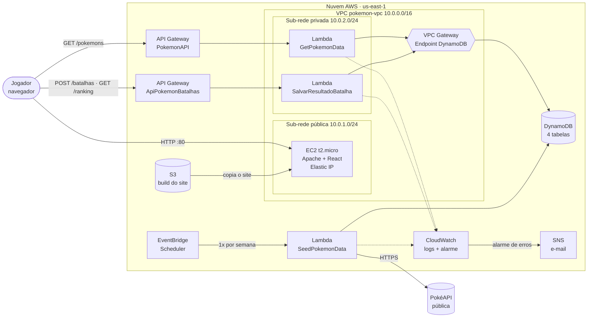

# Arena de Batalha Pokémon — Serverless na AWS

Jogo web de batalhas Pokémon por turnos. O jogador escolhe uma arena, monta um time de 3 Pokémon da 1ª geração e enfrenta um rival controlado pelo computador. Vitórias dão pontos, que desbloqueiam novas arenas, e o placar fica num ranking global.

Projeto da disciplina **GCT0149 — Redes de Computadores (2026/1)**. O enunciado pede uma arquitetura AWS que **consuma dados de uma API pública, trate, armazene e exiba numa página web**, com a rede separando o que é público do que é interno.

## Arquitetura



### Serviços AWS usados (10)

| Serviço | Papel no projeto |
|---|---|
| **Amazon VPC** | Rede própria `pokemon-vpc`, com sub-rede pública e privada, Internet Gateway e route tables separadas |
| **VPC Gateway Endpoint** | Rota privada da sub-rede privada até o DynamoDB, sem passar pela internet e sem custo |
| **Amazon EC2** | Servidor web (Apache) que entrega o jogo React. `t2.micro`, único recurso com IP público |
| **Elastic IP** | IP fixo para o EC2, que não muda quando o Learner Lab é reiniciado |
| **AWS Lambda** | 3 funções: coleta/validação, consulta do catálogo e registro de partidas |
| **Amazon API Gateway** | 2 HTTP APIs que expõem as Lambdas ao navegador, com CORS |
| **Amazon DynamoDB** | 4 tabelas sob demanda: catálogo, dados coletados, histórico e ranking |
| **Amazon S3** | Guarda o build do site; o EC2 copia de lá (deploy sem SSH) |
| **Amazon EventBridge Scheduler** | Roda a `SeedPokemonData` 1x por semana para manter o catálogo atualizado |
| **Amazon CloudWatch + SNS** | Logs das Lambdas e alarme que envia e-mail quando alguma função dá erro |

### Decisões de rede

- **Só o EC2 é público.** Ele fica na sub-rede pública, com rota `0.0.0.0/0` para o Internet Gateway. O Security Group libera apenas as portas 80 e 443; a 22 (SSH) não fica aberta para a internet.
- **As Lambdas que tocam no banco ficam na sub-rede privada**, que não tem rota para a internet. Elas alcançam o DynamoDB pelo **VPC Gateway Endpoint**. O DynamoDB é um serviço regional gerenciado: ele não fica *dentro* da VPC, o endpoint só cria um caminho privado até ele.
- **A `SeedPokemonData` roda fora da VPC** porque é a única que precisa sair para a internet (PokéAPI). Colocá-la na sub-rede privada exigiria um NAT Gateway, que custa por hora mesmo parado. Assim, a sub-rede privada continua sem nenhuma saída para a internet.
- **Os API Gateway são públicos** porque o navegador do jogador chama as APIs diretamente. Eles expõem apenas rotas específicas, nunca acesso à infraestrutura.

## Fluxo de dados

1. **Coleta** — o EventBridge (ou um teste manual) dispara a `SeedPokemonData`, que busca os Pokémon 1 a 151 na PokéAPI.
2. **Tratamento e validação** — a resposta da PokéAPI tem centenas de campos por Pokémon; a Lambda reduz a um formato enxuto (`pokemonId`, `name`, `type1`, `type2`, `hp`, `attack`, `defense`, `speed`, `sprite`) e valida cada campo. Grava em `PokemonCatalog` (pronto para o jogo) e `TabelaPokemons` (dados coletados com data e fonte).
3. **Exibição** — o jogador abre o site pelo IP do EC2. O React chama `GET /pokemons` → `GetPokemonData` → `PokemonCatalog`.
4. **Batalha** — ao fim da partida, o React envia `POST /batalhas` com nickname, arena, resultado e time. A `SalvarResultadoBatalha` valida, grava em `HistoricoBatalhas` e atualiza `RankingJogadores`.
5. **Ranking** — `GET /ranking` devolve os 10 melhores jogadores.

## Validação e tratamento dos dados

| Onde | O que é validado |
|---|---|
| `SeedPokemonData` | `id` igual ao pedido; nome com regex `^[a-z][a-z0-9-]{0,49}$`; 1 ou 2 tipos de uma lista dos 18 tipos oficiais; `hp`/`attack`/`defense`/`speed` inteiros entre 1 e 255; sprite com regex de URL `https://raw.githubusercontent.com/PokeAPI/...png`. Até 3 tentativas com espera crescente se a PokéAPI falhar. Um Pokémon inválido é registrado no log e pulado, sem derrubar a carga |
| `GetPokemonData` | `id` da URL com regex `^[1-9]\d{0,3}$` (bloqueia lixo/injeção); scan paginado do DynamoDB; conversão de `Decimal` para número; respostas 400/404/405/500 com mensagem clara |
| `SalvarResultadoBatalha` | JSON válido; nickname com regex `^[\p{L}\p{N} _-]{2,20}$` (aceita acentos); arena dentro das 7 existentes; resultado `vitoria` ou `derrota`; time com exatamente 3 ids distintos entre 1 e 151. Erros voltam juntos com status 422 |
| Front-end | Mesma regra de nickname aplicada antes de enviar (validação nos dois lados) |

**Pontuação calculada no servidor.** O navegador só informa o resultado; a Lambda soma +100 na vitória e −50 na derrota (mínimo 0) com um `UpdateItem` atômico. Ninguém consegue editar o JavaScript e se dar pontos, e duas abas abertas não sobrescrevem uma à outra.

## Tabelas DynamoDB

| Tabela | Chave | Guarda |
|---|---|---|
| `PokemonCatalog` | `pokemonId` (String) | Pokémon tratados, no formato que o jogo usa |
| `TabelaPokemons` | `id_pokemon` (String) | Dados coletados (altura, peso, experiência), fonte e data da coleta |
| `HistoricoBatalhas` | `partidaId` (String) + `dataHora` (String) | Cada partida jogada |
| `RankingJogadores` | `jogadorId` (String) | Pontos, vitórias e partidas por jogador |

Todas em modo **sob demanda** (paga por requisição).

## Estrutura do repositório

```
├── src/App.js                          # jogo (React)
├── lambdas/
│   ├── seed_pokemon_data/              # Python 3.12 · coleta e validação
│   ├── get_pokemon_data/               # Python 3.12 · GET /pokemons
│   └── salvar_resultado_batalha/       # Node.js 24.x · POST /batalhas, GET /ranking
├── infra/
│   ├── ec2-user-data.sh                # configura o Apache e copia o site do S3
│   └── deploy-frontend.sh              # build do React + envio para o S3
└── .env.example                        # URLs do API Gateway usadas no build
```

## Como implantar (AWS Academy Learner Lab, `us-east-1`)

No Learner Lab não é possível criar papéis IAM: use o **`LabRole`** em todas as Lambdas e na agenda do EventBridge, e o **`LabInstanceProfile`** no EC2.

1. **VPC** — crie `pokemon-vpc` (`10.0.0.0/16`), `subnet-publica` (`10.0.1.0/24`) e `subnet-privada` (`10.0.2.0/24`), o Internet Gateway `pokemon-igw` e a route table `rt-publica` com `0.0.0.0/0 → pokemon-igw` associada à sub-rede pública. Crie o Security Group `ec2-publico-sg` com entrada 80 e 443.
2. **Gateway Endpoint** — VPC → Endpoints → `com.amazonaws.us-east-1.dynamodb`, tipo Gateway, marcando a route table da sub-rede privada.
3. **DynamoDB** — crie as 4 tabelas da seção acima, com *Default settings*.
4. **Lambdas** — crie as 3 funções com o `LabRole` e cole o código da pasta `lambdas/`:
   - `SeedPokemonData`: Python 3.12, **sem VPC**, timeout **5 min**, variáveis `CATALOG_TABLE=PokemonCatalog`, `RAW_TABLE=TabelaPokemons`. Rode uma vez com o evento `{}`.
   - `GetPokemonData`: Python 3.12, VPC `pokemon-vpc` + `subnet-privada`, variável `CATALOG_TABLE=PokemonCatalog`.
   - `SalvarResultadoBatalha`: Node.js 24.x, arquivo `index.mjs`, VPC `pokemon-vpc` + `subnet-privada`, variáveis `HISTORY_TABLE=HistoricoBatalhas`, `RANKING_TABLE=RankingJogadores`.
5. **API Gateway** (HTTP API, stage `$default` com auto-deploy, CORS liberado para `GET`, `POST` e header `content-type`):
   - `PokemonAPI`: `GET /pokemons` e `GET /pokemons/{id}` → `GetPokemonData`.
   - `ApiPokemonBatalhas`: `POST /batalhas` e `GET /ranking` → `SalvarResultadoBatalha`.
6. **S3 + front-end** — crie um bucket (ex.: `arena-pokemon-site-seunome`, acesso público bloqueado). Copie `.env.example` para `.env`, coloque as duas Invoke URLs e rode `./infra/deploy-frontend.sh nome-do-bucket` (no CloudShell ou na sua máquina).
7. **EC2** — Amazon Linux 2023, `t2.micro`, `subnet-publica`, IP público ativado, `ec2-publico-sg`, perfil IAM `LabInstanceProfile`. Em *Advanced details → User data*, cole `infra/ec2-user-data.sh` com o nome do seu bucket. Depois, em **Elastic IPs**, aloque um IP e associe à instância.
8. **EventBridge Scheduler** — crie a agenda `atualizar-catalogo` com `rate(7 days)`, alvo Lambda `SeedPokemonData`, papel `LabRole`.
9. **Monitoramento** — no SNS, crie o tópico `alertas-arena` com assinatura por e-mail (confirme o e-mail recebido). No CloudWatch → Alarms, crie um alarme na métrica `Errors` das Lambdas (soma ≥ 1 em 5 min) que notifica o tópico.

## Testes rápidos

```bash
# catálogo completo e um Pokémon
curl https://SUA-POKEMON-API/pokemons
curl https://SUA-POKEMON-API/pokemons/25

# id inválido → 400
curl https://SUA-POKEMON-API/pokemons/abc

# registrar uma partida → 201
curl -X POST https://SUA-BATALHAS-API/batalhas \
  -H "content-type: application/json" \
  -d '{"nickname":"Ana","arena":"ginasio","resultado":"vitoria","time":["1","4","7"]}'

# dados inválidos → 422 com a lista de erros
curl -X POST https://SUA-BATALHAS-API/batalhas \
  -H "content-type: application/json" \
  -d '{"nickname":"x","arena":"lua","resultado":"ganhei","time":["999"]}'

# ranking
curl https://SUA-BATALHAS-API/ranking
```

## Custo e eficiência

- **EC2 `t2.micro`**: elegível ao free tier; é o único recurso que fica ligado o tempo todo.
- **Lambda, API Gateway e DynamoDB sob demanda**: cobram por uso; sem jogadores, o custo é praticamente zero.
- **Sem NAT Gateway**: a sub-rede privada só fala com o DynamoDB pelo Gateway Endpoint, que é gratuito. A única Lambda que precisa de internet roda fora da VPC.
- **Catálogo em cache no DynamoDB**: a PokéAPI é consultada 1x por semana, não a cada jogador. A resposta de `/pokemons` ainda envia `Cache-Control` de 5 minutos para o navegador.
- **Elastic IP**: desde 2024 a AWS cobra cerca de US$ 0,005/hora por qualquer IPv4 público, inclusive o IP automático do EC2. O Elastic IP não aumenta esse custo e evita que o endereço do jogo mude a cada reinício do lab. Libere o IP quando o projeto terminar.

## Rodar o front-end localmente

```bash
cp .env.example .env   # e preencha as URLs
npm install
npm start              # http://localhost:3000
```
